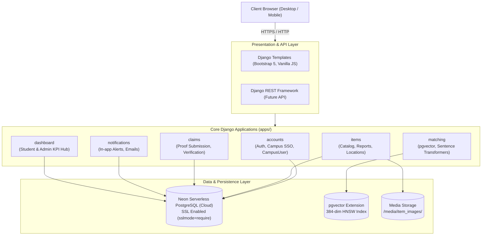

# Campus Lost & Found Hub — System Architecture

## 1. Architectural Overview

**Campus Lost & Found Hub** is designed as a modular, monolithic Django application with high cohesion, loose coupling, and clean domain boundaries. The system prioritizes simplicity, reliability, and security, eschewing complex distributed microservices in favor of Django's battle-tested application structure backed by **Neon Cloud PostgreSQL** and the **pgvector** extension.



---

## 2. Technology Stack

| Layer | Technology | Specification | Rationale |
| :--- | :--- | :--- | :--- |
| **Language** | Python | 3.11+ (running 3.14.3) | Standard modern Python with strong typing, performance improvements, and ecosystem support. |
| **Framework** | Django | 6.1.x / 5.1+ | Robust, secure, batteries-included web framework with native ORM, authentication, and templating. |
| **API Engine** | Django REST Framework | 3.18.x | Modular REST API capabilities for future mobile client and single-page integrations. |
| **Database** | Neon PostgreSQL | Hosted Serverless PostgreSQL | Cloud-native serverless PostgreSQL with autoscaling, SSL encryption, and native pgvector support. |
| **Vector Engine** | pgvector | Built-in Extension / 0.5.x (Python) | High-performance vector similarity search natively in PostgreSQL, eliminating separate vector database infrastructure. |
| **User Identity** | `CampusUser` | `AbstractUser` Subclass | Configured as `AUTH_USER_MODEL` in Phase 0.1 before dependent model migrations to prevent schema migration locks. |
| **Styling** | Bootstrap 5 | 5.3.x & Bootstrap Icons | Responsive, accessible CSS framework with customized campus navy/blue design tokens. |
| **Interactivity**| Vanilla JavaScript | ES6+ | Lightweight, dependency-free DOM manipulation without bloated node_modules or frontend builds. |
| **Configuration**| django-environ | 0.14.x | Strictly 12-Factor App compliant environment variable management via `DATABASE_URL`. |
| **Imaging** | Pillow | 13.x | Image processing, thumbnail generation, and metadata sanitization for item uploads. |

---

## 3. Application Responsibilities & User Model Timing

### 3.1. `apps/accounts` (Custom User Model Timing)
- **Scope**: Identity and access management.
- **Architectural Timing Decision (Phase 0.1)**:
  - In Django, introducing `AUTH_USER_MODEL` after foreign keys or initial migrations exist is notoriously disruptive.
  - To ensure stability, the foundational `CampusUser` model (subclassing `AbstractUser`) and its initial migration `accounts.0001_initial` are created in **Phase 0.1**.
  - All standard Django apps (`admin`, `auth`, `sessions`) reference `accounts.CampusUser` from inception.
  - Future Phase 1 implementations will add student profile attributes (`campus_id`, `department`, `role`, verification statuses) cleanly without breaking authentication schema dependencies.

### 3.2. `apps/items`
- **Scope**: Core Lost & Found reporting and directory.
- **Responsibilities**:
  - CRUD operations for Lost and Found reports.
  - Multi-category hierarchy (`Category`: Electronics, Cards, Books, etc.).
  - Campus spatial tagging (`CampusLocation`: Building, Floor, Room).
  - Image uploads and thumbnail generation via Pillow.
  - Public search and filtering by date, status, category, and location.

### 3.3. `apps/matching`
- **Scope**: Artificial intelligence and semantic matching engine.
- **Responsibilities**:
  - PostgreSQL extension initialization via `VectorExtension()` migration operation.
  - Text embedding generation using `all-MiniLM-L6-v2` (384-dimensional dense vectors).
  - Vector similarity calculation via pgvector cosine distance operator (`<=>`).
  - Hybrid scoring pipeline integrating semantic text match with structured heuristics (category, location proximity, date proximity).
  - Generation and storage of `PotentialMatch` candidate pairs.

### 3.4. `apps/claims`
- **Scope**: Ownership dispute resolution and item reclamation.
- **Responsibilities**:
  - Claim submission workflow by students claiming lost belongings.
  - Secure verification evidence collection (receipts, unique scratches, unlock passwords, serial numbers).
  - Multi-step status state machine (`SUBMITTED`, `UNDER_REVIEW`, `APPROVED`, `REJECTED`, `COLLECTED`).
  - Administrative audit logging and resolution notes.

### 3.5. `apps/notifications`
- **Scope**: In-app and outbound communication.
- **Responsibilities**:
  - Delivery of automated match alerts when potential items are reported.
  - Status updates on submitted claims.
  - Campus security broadcasts regarding high-value lost items.
  - In-app notification center with read/unread tracking.

### 3.6. `apps/dashboard`
- **Scope**: User and administrator analytics and command center.
- **Responsibilities**:
  - Student dashboard: active lost reports, found items submitted, and claim progress.
  - Security / Admin console: item recovery rates, unresolved claim queues, inventory aging metrics.

---

## 4. Database Architecture & Vector Strategy

### 4.1. Neon PostgreSQL Connection
- Connecting through `DATABASE_URL` environment variable.
- Connection URL format:
  ```
  postgresql://[user]:[password]@[endpoint].neon.tech/[dbname]?sslmode=require
  ```
- SSL (`sslmode=require`) is enforced for all Neon connections.
- Credentials are strictly excluded from version control and logs.

### 4.2. Vector Integration Strategy
- Integrated via the `pgvector` Python library (`pgvector.django`).
- The matching app maintains the database extension migration `apps/matching/migrations/0001_initial.py` which executes `VectorExtension()`.
- Neon natively supports `CREATE EXTENSION IF NOT EXISTS vector;`.
- Employs 384-dimensional dense vectors generated by the lightweight Sentence Transformer model `all-MiniLM-L6-v2`.
- Indexing will leverage PostgreSQL HNSW (Hierarchical Navigable Small World) indices for sub-millisecond approximate nearest neighbor (ANN) retrieval.
