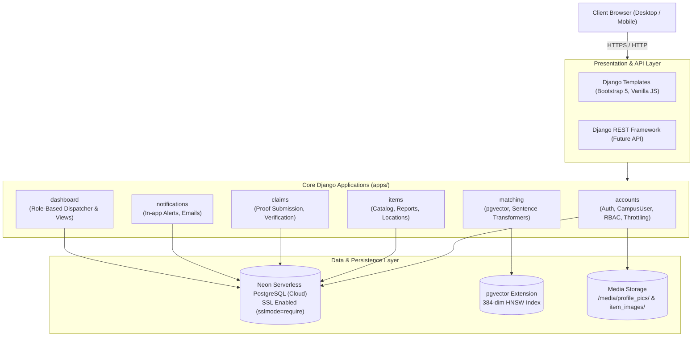
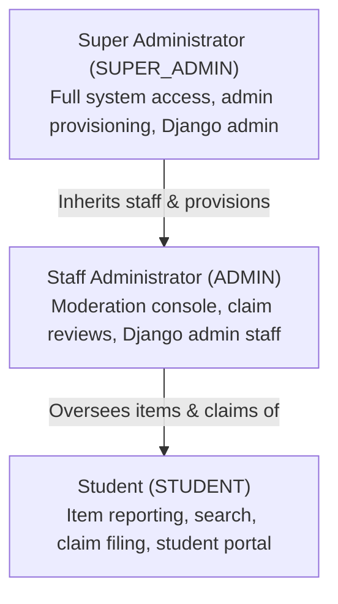
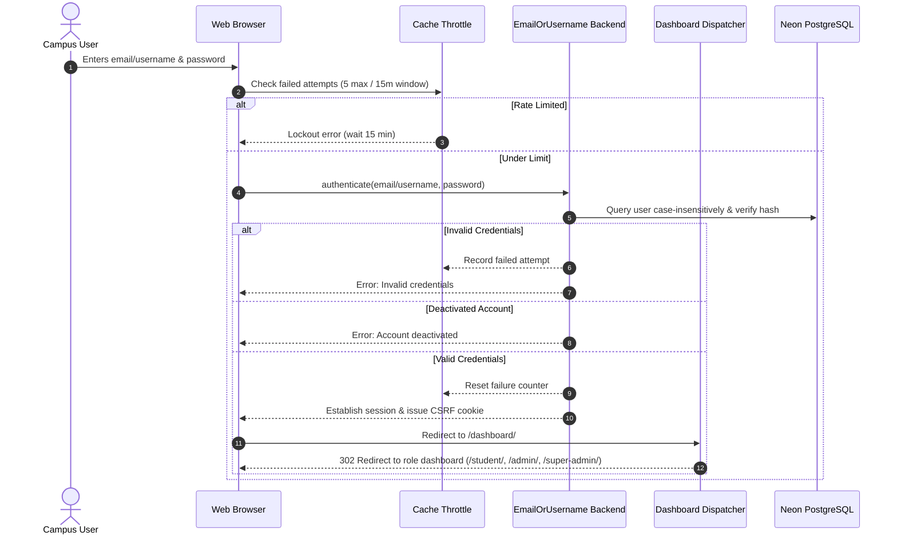

# Campus Lost & Found Hub — System Architecture

## 1. Architectural Overview

**Campus Lost & Found Hub** is designed as a modular, monolithic Django application with high cohesion, loose coupling, and clean domain boundaries. The system prioritizes simplicity, reliability, and security, eschewing complex distributed microservices in favor of Django's battle-tested application structure backed by **Neon Cloud PostgreSQL** and the **pgvector** extension.



---

## 2. Technology Stack

| Layer | Technology | Specification | Rationale |
| :--- | :--- | :--- | :--- |
| **Language** | Python | 3.11+ (running 3.14.3) | Standard modern Python with strong typing, performance improvements, and ecosystem support. |
| **Framework** | Django | 6.1.x / 5.1+ | Robust, secure, batteries-included web framework with native ORM, authentication, and templating. |
| **API Engine** | Django REST Framework | 3.18.x | Modular REST API capabilities for future mobile client and single-page integrations. |
| **Database** | Neon PostgreSQL | Hosted Serverless PostgreSQL | Cloud-native serverless PostgreSQL with autoscaling, SSL encryption, and native pgvector support. |
| **Vector Engine** | pgvector | Built-in Extension / 0.8.6 (Cloud) | High-performance vector similarity search natively in PostgreSQL, eliminating separate vector database infrastructure. |
| **User Identity** | `CampusUser` | `AbstractUser` Subclass | Configured as `AUTH_USER_MODEL` with RBAC (`STUDENT`, `ADMIN`, `SUPER_ADMIN`), conditional unique `student_id`, and email normalization. |
| **Styling** | Bootstrap 5 | 5.3.x & Bootstrap Icons | Responsive, accessible CSS framework with customized campus navy/blue design tokens (`#0f2942`). |
| **Interactivity**| Vanilla JavaScript | ES6+ | Lightweight, dependency-free DOM manipulation without bloated node_modules or frontend builds. |
| **Configuration**| django-environ | 0.14.x | Strictly 12-Factor App compliant environment variable management via `DATABASE_URL`. |
| **Imaging** | Pillow | 13.x | Profile avatar validation (max 2MB, format validation) and future item image uploads. |

---

## 3. Authentication & User Management Architecture (Phase 1)

### 3.1. Role-Based Access Control (RBAC) Hierarchy

The platform defines three strictly segregated user tiers:



- **STUDENT**: The self-service tier. Created exclusively through student registration. Automatically assigned `role=STUDENT`, `is_staff=False`, `is_superuser=False`.
- **ADMIN**: Operational staff (campus lost & found desk, security, facility leads). Can only be provisioned by a Super Admin via `/accounts/admin/provision/`. Automatically assigned `is_staff=True`, `is_superuser=False`.
- **SUPER_ADMIN**: Complete system governance, staff provisioning, and full Django administrative access (`is_staff=True`, `is_superuser=True`).

### 3.2. Authentication Flow & Security Mechanisms



### 3.3. Key Security Controls

1. **Email Normalization & Case-Insensitive Auth**:
   - `clean()` and `save()` on `CampusUser` systematically normalize email addresses to lowercase.
   - `EmailOrUsernameModelBackend` queries using case-insensitive matching (`email__iexact` or `username__iexact`).

2. **University Email Domain Gating**:
   - Environment-driven configuration via `UNIVERSITY_EMAIL_DOMAINS` (default: `university.edu`).
   - Self-service registration rejects any unauthorized external email domains.

3. **Conditional Student ID Uniqueness**:
   - `student_id` is required and enforced unique for students using a PostgreSQL conditional constraint:
     `UniqueConstraint(fields=['student_id'], condition=Q(student_id__isnull=False) & ~Q(student_id=''))`.
   - Admin accounts can leave `student_id` blank without triggering collision.

4. **Brute-Force Lockout (Throttling)**:
   - Evaluated by `apps.accounts.throttling`.
   - Client IP + normalized identifier tracked in Django cache with a sliding 15-minute window.
   - Account login locked after 5 consecutive failed attempts.

5. **Strict Parameter Tamper Resistance**:
   - `ProfileUpdateForm` explicitly restricts editable fields to `first_name`, `last_name`, `phone_number`, and `profile_picture`.
   - Security-critical fields (`role`, `student_id`, `email`, `is_email_verified`, `is_staff`, `is_superuser`) cannot be modified through the profile view.

6. **POST-Only Safe Logout**:
   - User logout requires a valid POST request with an accompanying CSRF token.
   - GET requests to `/accounts/logout/` are redirected safely to `home` without destroying the session.

---

## 4. Application Directory & Module Structure

```
campus_lost_found/
    manage.py
    config/
        settings.py          # Unified settings, DB routing, auth backends, domain configs
        urls.py              # Root router connecting apps
        wsgi.py / asgi.py    # Deployment gateways
    apps/
        accounts/            # Identity, CampusUser, backends, forms, throttling, views
            models.py
            backends.py      # Case-insensitive email/username backend
            throttling.py    # Sliding window brute-force lockout
            permissions.py   # RBAC mixins and decorators
            forms.py         # Registration, login, profile, admin provisioning
            views.py         # Auth views (CBVs)
            urls.py          # /accounts/*
            tests.py         # 25+ automated unit tests
        items/               # Future item reporting and catalog (Phase 2)
        matching/            # Semantic pgvector engine (Phase 3)
        claims/              # Ownership verification (Phase 4)
        notifications/       # Notification delivery (Phase 5)
        dashboard/           # Role dispatching and dashboards
            views.py         # DashboardDispatcher, Student, Admin, SuperAdmin views
            urls.py          # /dashboard/*
            tests.py         # Dashboard role tests
    templates/
        base.html            # Global skeleton (Bootstrap 5, main.css)
        components/          # navbar, footer, messages
        accounts/            # register.html, login.html, profile.html, create_admin.html
        dashboard/           # student.html, admin.html, super_admin.html
    static/
        css/main.css         # Navy theme design tokens
        js/main.js           # Client interactions
    docs/
        ARCHITECTURE.md      # Architecture and security specifications
        DATABASE_SCHEMA.md   # Model definitions and ER diagrams
        DEVELOPMENT_LOG.md   # Mandatory development diagnostics log
        IMPLEMENTATION_STATUS.md # Roadmaps and phase checklist
```
