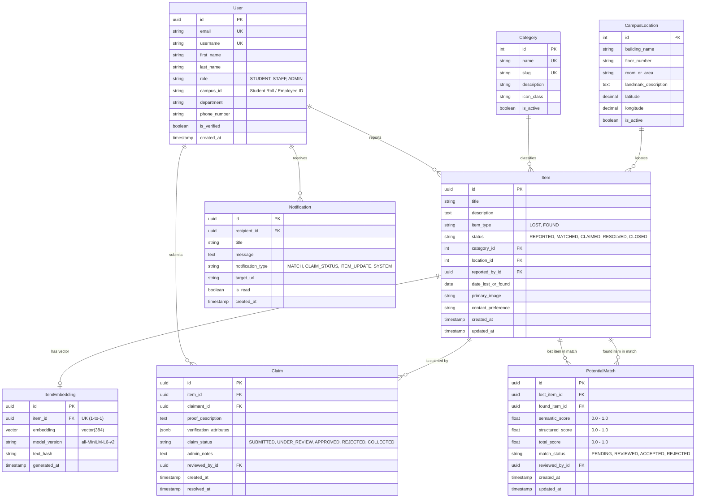

# Campus Lost & Found Hub — Planned Database Schema

> [!NOTE]
> This document details the complete relational and vector database schema planned for the platform.
> In accordance with the Phase 0 scope, **these models are intentionally not implemented yet** in the codebase.
> They will be incrementally introduced in their respective roadmap phases (Phase 1 through Phase 5).

---

## 1. Entity-Relationship Overview

---

## 2. Model Specifications

### 2.1. `User` (Scheduled: Phase 1)
- **Table**: `accounts_user`
- **Inheritance**: `django.contrib.auth.models.AbstractUser`
- **Fields**:
  - `id`: UUID, Primary Key, default `uuid.uuid4`.
  - `email`: EmailField, Unique, campus email constraint (`@university.edu`).
  - `campus_id`: CharField(30), unique campus registration or student roll number.
  - `role`: CharField(20), choices: `STUDENT`, `STAFF`, `SECURITY_ADMIN`.
  - `department`: CharField(100), academic department (e.g., Computer Science, Mechanical).
  - `phone_number`: CharField(15), optional direct contact for verified recovery.
  - `is_verified`: BooleanField, default `False` (email/campus identity verified).

### 2.2. `Category` (Scheduled: Phase 2)
- **Table**: `items_category`
- **Fields**:
  - `id`: AutoField, Primary Key.
  - `name`: CharField(100), unique (e.g., "Electronics", "IDs & Cards", "Bags & Backpacks").
  - `slug`: SlugField(120), unique.
  - `description`: TextField, optional guidance on what belongings fall here.
  - `icon_class`: CharField(50), Bootstrap icon identifier (e.g., `bi-laptop`).
  - `is_active`: BooleanField, default `True`.

### 2.3. `CampusLocation` (Scheduled: Phase 2)
- **Table**: `items_campuslocation`
- **Fields**:
  - `id`: AutoField, Primary Key.
  - `building_name`: CharField(120) (e.g., "Central Library", "Engineering Block B").
  - `floor_number`: CharField(30) (e.g., "Ground Floor", "Level 2").
  - `room_or_area`: CharField(120) (e.g., "Reading Room 204", "Cafeteria South Corner").
  - `landmark_description`: TextField, helpful visual landmarks.
  - `latitude` / `longitude`: DecimalField(9, 6), optional GPS coordinates for proximity calculations.

### 2.4. `Item` (Scheduled: Phase 2)
- **Table**: `items_item`
- **Fields**:
  - `id`: UUID, Primary Key.
  - `title`: CharField(200) (e.g., "Black Dell XPS 15 Laptop with GitHub sticker").
  - `description`: TextField (detailed narrative of appearance, contents, circumstances).
  - `item_type`: CharField(10), choices: `LOST`, `FOUND`.
  - `status`: CharField(20), choices: `REPORTED`, `MATCHED`, `CLAIMED`, `RESOLVED`, `CLOSED`.
  - `category`: ForeignKey to `Category`, `on_delete=models.PROTECT`.
  - `location`: ForeignKey to `CampusLocation`, `on_delete=models.SET_NULL`, null=True.
  - `reported_by`: ForeignKey to `User`, `on_delete=models.CASCADE`.
  - `date_lost_or_found`: DateField.
  - `primary_image`: ImageField upload to `item_images/%Y/%m/`.
  - `created_at` / `updated_at`: DateTimeField with auto-timestamps.

### 2.5. `ItemEmbedding` (Scheduled: Phase 3)
- **Table**: `matching_itemembedding`
- **Fields**:
  - `id`: UUID, Primary Key.
  - `item`: OneToOneField to `Item`, `on_delete=models.CASCADE`.
  - `embedding`: `pgvector.django.VectorField(dimensions=384)` storing dense text representation.
  - `model_version`: CharField(60), default `"all-MiniLM-L6-v2"`.
  - `text_hash`: CharField(64) SHA-256 hash of concatenated title and description to avoid duplicate inference.
  - `generated_at`: DateTimeField.
- **Index**: HNSW index using cosine distance operator.

### 2.6. `PotentialMatch` (Scheduled: Phase 3)
- **Table**: `matching_potentialmatch`
- **Fields**:
  - `id`: UUID, Primary Key.
  - `lost_item`: ForeignKey to `Item` (type=LOST), `related_name='lost_matches'`.
  - `found_item`: ForeignKey to `Item` (type=FOUND), `related_name='found_matches'`.
  - `semantic_score`: FloatField, cosine similarity ($0.0 \dots 1.0$).
  - `structured_score`: FloatField, weighted heuristic score ($0.0 \dots 1.0$).
  - `total_score`: FloatField, composite hybrid ranking score ($0.0 \dots 1.0$).
  - `match_status`: CharField(20), choices: `PENDING`, `REVIEWED`, `ACCEPTED`, `REJECTED`.
  - `reviewed_by`: ForeignKey to `User`, null=True.
  - `created_at` / `updated_at`: DateTimeField.
- **Constraints**: UniqueConstraint on `(lost_item, found_item)`.

### 2.7. `Claim` (Scheduled: Phase 4)
- **Table**: `claims_claim`
- **Fields**:
  - `id`: UUID, Primary Key.
  - `item`: ForeignKey to `Item`, `on_delete=models.CASCADE`.
  - `claimant`: ForeignKey to `User`, `on_delete=models.CASCADE`.
  - `proof_description`: TextField (detailed answers to verification challenges, serial numbers).
  - `verification_attributes`: JSONField (stores uploaded receipts, matching marks, photo links).
  - `claim_status`: CharField(20), choices: `SUBMITTED`, `UNDER_REVIEW`, `APPROVED`, `REJECTED`, `COLLECTED`.
  - `admin_notes`: TextField, internal review comments by campus security.
  - `reviewed_by`: ForeignKey to `User`, null=True.
  - `created_at` / `resolved_at`: DateTimeField.

### 2.8. `Notification` (Scheduled: Phase 5)
- **Table**: `notifications_notification`
- **Fields**:
  - `id`: UUID, Primary Key.
  - `recipient`: ForeignKey to `User`, `on_delete=models.CASCADE`.
  - `title`: CharField(150).
  - `message`: TextField.
  - `notification_type`: CharField(25), choices: `MATCH`, `CLAIM_STATUS`, `ITEM_UPDATE`, `SYSTEM`.
  - `target_url`: CharField(255), link to relevant item, match, or claim.
  - `is_read`: BooleanField, default `False`.
  - `created_at`: DateTimeField.
