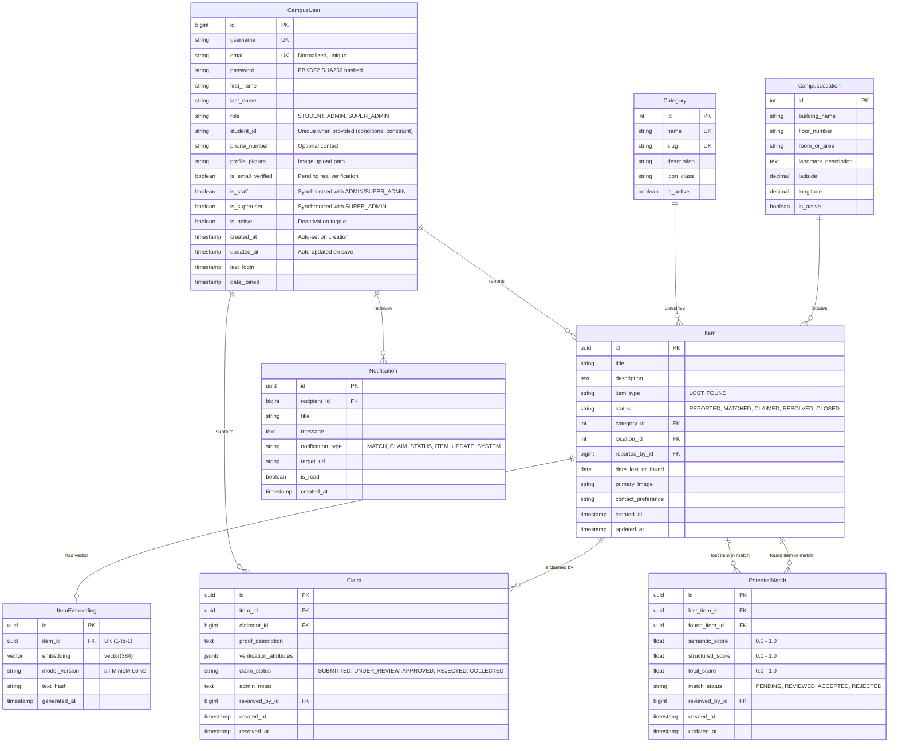

# Campus Lost & Found Hub — Database Schema Documentation

> [!NOTE]
> **Phase 1 Update**: The `CampusUser` custom authentication model is fully implemented, verified, and migrated under `apps.accounts.models.CampusUser`.
> Subsequent domain models (`Item`, `ItemEmbedding`, `PotentialMatch`, `Claim`, `Notification`) are planned for Phase 2 through Phase 5.

---

## 1. Entity-Relationship Overview

---

## 2. Model Specifications

### 2.1. `CampusUser` (Implemented in Phase 1)
- **Application**: `apps.accounts`
- **Model**: `CampusUser` (inherits `django.contrib.auth.models.AbstractUser`)
- **Table**: `accounts_campususer`
- **Active Migration History**:
  - `0001_initial.py`: AbstractUser baseline.
  - `0002_campususer_created_at_campususer_is_email_verified_and_more.py`: Domain, role, student_id, phone, avatar, timestamps, and constraints.
- **Fields**:
  - `id`: BigAutoField, Primary Key.
  - `email`: `EmailField`, unique, case-normalized in `clean()` and `save()`.
  - `username`: `CharField(150)`, unique. Automatically synchronized with lowercase email during registration.
  - `role`: `CharField(20)`, choices: `STUDENT`, `ADMIN`, `SUPER_ADMIN`. Default `STUDENT`.
  - `student_id`: `CharField(50)`, optional, stores unique university student registration / roll number.
  - `phone_number`: `CharField(20)`, optional contact number for recovery notifications.
  - `profile_picture`: `ImageField(upload_to="profile_pics/%Y/%m/")`, optional avatar with max 2MB validation.
  - `is_email_verified`: `BooleanField`, default `False`.
  - `created_at`: `DateTimeField(default=timezone.now, editable=False)`.
  - `updated_at`: `DateTimeField(auto_now=True)`.
  - Standard Django fields: `is_staff`, `is_superuser`, `is_active`, `date_joined`, `last_login`.
- **Database Constraints**:
  - `unique_student_id_when_provided`: `UniqueConstraint(fields=['student_id'], condition=Q(student_id__isnull=False) & ~Q(student_id=''))`. Ensures students have unique registration numbers while permitting null/empty values for administrators.
- **Role Synchronization**:
  - `SUPER_ADMIN`: `is_staff=True`, `is_superuser=True`.
  - `ADMIN`: `is_staff=True`, `is_superuser=False`.
  - `STUDENT`: `is_staff=False`, `is_superuser=False`.

---

### 2.2. `Category` (Implemented in Phase 2)
- **Application**: `apps.items`
- **Table**: `items_category`
- **Fields**:
  - `id`: BigAutoField, Primary Key.
  - `name`: `CharField(100)`, unique (e.g., "Electronics", "IDs & Cards", "Bags & Backpacks").
  - `description`: `TextField(blank=True)`, guidance on what belongings fall here.
  - `is_active`: `BooleanField(default=True)`, enables soft retirement without breaking foreign key history.
  - `created_at`: `DateTimeField(auto_now_add=True)`.

---

### 2.3. `CampusLocation` (Implemented in Phase 2)
- **Application**: `apps.items`
- **Table**: `items_campuslocation`
- **Fields**:
  - `id`: BigAutoField, Primary Key.
  - `name`: `CharField(150)`, unique (e.g., "Central Library", "Main Cafeteria").
  - `description`: `TextField(blank=True)`, room numbers, floor indicators, or visual landmarks.
  - `is_active`: `BooleanField(default=True)`, enables location deprecation while preserving history.
  - `created_at`: `DateTimeField(auto_now_add=True)`.

---

### 2.4. `Item` (Implemented in Phase 2)
- **Application**: `apps.items`
- **Table**: `items_item`
- **Fields**:
  - `id`: `UUIDField(primary_key=True, default=uuid.uuid4, editable=False)`.
  - `title`: `CharField(200)`, clear item title.
  - `description`: `TextField`, detailed characteristics, distinguishing marks, colors, contents.
  - `item_type`: `CharField(10)`, choices: `LOST` ("Lost Item"), `FOUND` ("Found Item"). Indexed.
  - `category`: `ForeignKey(Category, on_delete=models.PROTECT, related_name="items")`.
  - `location`: `ForeignKey(CampusLocation, on_delete=models.PROTECT, related_name="items")`.
  - `date_lost_or_found`: `DateField`, incident date; validated to never be in the future. Indexed.
  - `image`: `ImageField(upload_to=item_image_upload_path, blank=True, null=True)`, validated via Pillow (max 5 MB, JPEG/PNG/WEBP formats).
  - `reported_by`: `ForeignKey(CampusUser, on_delete=models.CASCADE, related_name="reported_items")`.
  - `status`: `CharField(20)`, choices: `OPEN` ("Open"), `CLAIM_PENDING` ("Claim Pending"), `RESOLVED` ("Resolved"), `CLOSED` ("Closed"). Default `OPEN`. Indexed.
  - `created_at`: `DateTimeField(auto_now_add=True)`. Indexed.
  - `updated_at`: `DateTimeField(auto_now=True)`.
- **Database Indexes**:
  - `[item_type, status, -created_at]` (composite index for rapid filtering of active catalog listings).
  - Individual indexes on `item_type`, `status`, `date_lost_or_found`, `created_at`.
- **Properties & Privacy Controls**:
  - `is_lost`, `is_found`, `is_open`, `is_resolved`, `is_closed`, `is_claim_pending` (convenience boolean query helpers).
  - `reporter_display_name`: Strictly returns `full_name` or `username`. Guarantees that sensitive attributes (`email`, `phone_number`, `student_id`) are never exposed in public views or API payloads.

### 2.5. `ItemEmbedding` (Scheduled: Phase 3)
- **Table**: `matching_itemembedding`
- **Fields**:
  - `id`: UUID, Primary Key.
  - `item`: OneToOneField to `Item`, `on_delete=models.CASCADE`.
  - `embedding`: `pgvector.django.VectorField(dimensions=384)` storing dense text representation.
  - `model_version`: CharField(60), default `"all-MiniLM-L6-v2"`.
  - `text_hash`: CharField(64) SHA-256 hash.
  - `generated_at`: DateTimeField.
- **Index**: HNSW index using cosine distance operator.

### 2.6. `PotentialMatch` (Scheduled: Phase 3)
- **Table**: `matching_potentialmatch`
- **Fields**:
  - `id`: UUID, Primary Key.
  - `lost_item`: ForeignKey to `Item` (type=LOST), `related_name='lost_matches'`.
  - `found_item`: ForeignKey to `Item` (type=FOUND), `related_name='found_matches'`.
  - `semantic_score`: FloatField ($0.0 \dots 1.0$).
  - `structured_score`: FloatField ($0.0 \dots 1.0$).
  - `total_score`: FloatField ($0.0 \dots 1.0$).
  - `match_status`: CharField(20), choices: `PENDING`, `REVIEWED`, `ACCEPTED`, `REJECTED`.
  - `reviewed_by`: ForeignKey to `CampusUser`, null=True.
  - `created_at` / `updated_at`: DateTimeField.

### 2.7. `Claim` (Scheduled: Phase 4)
- **Table**: `claims_claim`
- **Fields**:
  - `id`: UUID, Primary Key.
  - `item`: ForeignKey to `Item`, `on_delete=models.CASCADE`.
  - `claimant`: ForeignKey to `CampusUser`, `on_delete=models.CASCADE`.
  - `proof_description`: TextField.
  - `verification_attributes`: JSONField.
  - `claim_status`: CharField(20), choices: `SUBMITTED`, `UNDER_REVIEW`, `APPROVED`, `REJECTED`, `COLLECTED`.
  - `admin_notes`: TextField.
  - `reviewed_by`: ForeignKey to `CampusUser`, null=True.
  - `created_at` / `resolved_at`: DateTimeField.

### 2.8. `Notification` (Scheduled: Phase 5)
- **Table**: `notifications_notification`
- **Fields**:
  - `id`: UUID, Primary Key.
  - `recipient`: ForeignKey to `CampusUser`, `on_delete=models.CASCADE`.
  - `title`: CharField(150).
  - `message`: TextField.
  - `notification_type`: CharField(25), choices: `MATCH`, `CLAIM_STATUS`, `ITEM_UPDATE`, `SYSTEM`.
  - `target_url`: CharField(255).
  - `is_read`: BooleanField, default `False`.
  - `created_at`: DateTimeField.
