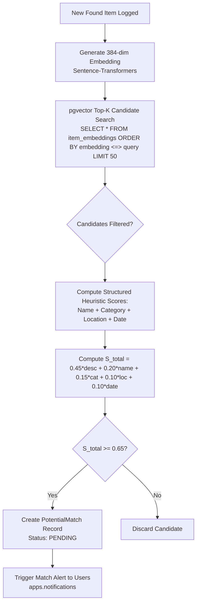

# Campus Lost & Found Hub — Intelligent Matching Engine Architecture

## 1. Overview

A critical innovation of the **Campus Lost & Found Hub** is its hybrid semantic matching engine. Traditional lost and found systems rely on exact keyword searches, which frequently fail when students describe the same object with different vocabularies (e.g., *"Navy blue water flask"* vs. *"Dark blue HydroFlask bottle"*).

To overcome this, the platform combines **dense semantic vector embeddings** with **structured heuristic rules** into a unified composite ranking score.

---

## 2. Model & Embedding Pipeline

### 2.1. Transformer Model
- **Model**: `sentence-transformers/all-MiniLM-L6-v2`
- **Embedding Dimensions**: $D = 384$
- **Inference Footprint**: Lightweight (~80MB), optimized for CPU inference on standard university servers without requiring high-end dedicated GPUs.
- **Normalization**: Vector embeddings are $L_2$-normalized so that inner product and cosine similarity are computationally equivalent:
  $$\| \mathbf{v} \|_2 = 1 \implies \mathbf{u} \cdot \mathbf{v} = \cos(\theta)$$

### 2.2. Text Serialization
Before generating the dense vector, item attributes are composed into structured text representations:
- **Title Text**: Cleaned title without extraneous punctuation.
- **Contextual Narrative**:
  ```
  Item: {title}. Category: {category_name}. Color & Details: {description}. Found/Lost at {building_name}.
  ```

---

## 3. Storage & Nearest Neighbor Retrieval (pgvector)

The vectors are persisted directly inside PostgreSQL using the `pgvector` extension:

```sql
-- Schema representation in matching_itemembedding
CREATE TABLE matching_itemembedding (
    id UUID PRIMARY KEY,
    item_id UUID UNIQUE REFERENCES items_item(id) ON DELETE CASCADE,
    embedding vector(384) NOT NULL,
    model_version VARCHAR(60) NOT NULL DEFAULT 'all-MiniLM-L6-v2',
    text_hash VARCHAR(64) NOT NULL,
    generated_at TIMESTAMP WITH TIME ZONE NOT NULL
);

-- Fast Approximate Nearest Neighbor (ANN) index using Cosine Distance
CREATE INDEX idx_item_embedding_cosine 
ON matching_itemembedding 
USING hnsw (embedding vector_cosine_ops)
WITH (m = 16, ef_construction = 64);
```

### 3.1. Cosine Distance to Similarity Conversion
In pgvector, the cosine distance operator `<=>` produces a distance $d \in [0, 2]$.
The similarity score $S_{sem} \in [0, 1]$ is computed as:
$$S_{sem} = 1 - \frac{d_{cosine}}{2} \quad \text{or for unit vectors} \quad S_{sem} = 1 - (\mathbf{u} \Leftrightarrow \mathbf{v})$$

---

## 4. Hybrid Composite Ranking Algorithm

Vector similarity alone can be susceptible to false positives (e.g., matching a lost laptop in 2024 to a found laptop in 2026, or matching items in different campuses). Therefore, candidate matches retrieved from pgvector pass through a structured attribute scoring filter.

### 4.1. Planned Scoring Weights

The composite match score $S_{total}$ is calculated as a weighted linear combination of five components:

| Component | Weight ($w_i$) | Description | Metric |
| :--- | :--- | :--- | :--- |
| **Description Similarity** ($S_{desc}$) | **45%** (0.45) | Dense vector cosine similarity between narrative descriptions. | Cosine similarity ($0 \dots 1$) |
| **Item Name Similarity** ($S_{name}$) | **20%** (0.20) | Token overlap and vector similarity of item titles. | Cosine / Token Jaccard ($0 \dots 1$) |
| **Category Match** ($S_{cat}$) | **15%** (0.15) | Exact category match or compatible category branch. | 1.0 (exact match) / 0.5 (same parent) / 0.0 |
| **Location Proximity** ($S_{loc}$) | **10%** (0.10) | Building and room co-location on campus. | 1.0 (same room) / 0.75 (same building) / 0.3 (adjacent) / 0.0 |
| **Date Proximity** ($S_{date}$) | **10%** (0.10) | Temporal delta between reported lost and found dates. | Exponential decay: $e^{-\lambda \cdot |\Delta t|}$ |

### 4.2. Composite Scoring Formula

$$S_{total} = 0.45 \cdot S_{desc} + 0.20 \cdot S_{name} + 0.15 \cdot S_{cat} + 0.10 \cdot S_{loc} + 0.10 \cdot S_{date}$$

Where:
- $S_{total} \in [0.0, 1.0]$.
- **Date Proximity Function**:
  $$S_{date} = \begin{cases} 
  1.0 & \text{if } |\Delta t| \le 1 \text{ day} \\
  \max\left(0, 1 - \frac{|\Delta t| - 1}{30}\right) & \text{if } 1 < |\Delta t| \le 30 \text{ days} \\
  0.0 & \text{if } |\Delta t| > 30 \text{ days}
  \end{cases}$$

> [!NOTE]
> **Validation Notice**: These initial ranking weights (45/20/15/10/10) reflect baseline domain heuristics.
> During **Phase 3 implementation**, they will undergo quantitative validation using a synthetic and labeled benchmark dataset of paired campus reports to fine-tune weights and threshold values.

---

## 5. Candidate Match Generation Workflow



1. **Trigger**: When an item of type `FOUND` is submitted or updated, an asynchronous task generates its dense embedding.
2. **First-Stage Retrieval (High Recall)**: Query PostgreSQL using pgvector cosine distance to retrieve top $k = 50$ candidate `LOST` items.
3. **Second-Stage Ranking (High Precision)**: Compute the composite score $S_{total}$ across all retrieved candidates.
4. **Thresholding**: Candidate pairs with $S_{total} \ge 0.65$ are saved into the `matching_potentialmatch` table.
5. **Notification Dispatch**: Notifications are dispatched to both the finder and the potential owner to review the suggested match.
